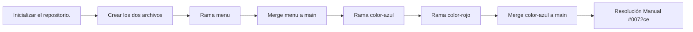

# Ramas, merge y resolucion de conflicto


Uso de ramas y merge. Proyecto que consiste en crear una pagina web de dos archivos, abrir ramas sobre estas, unirlas y provocar conflictos para aprender a resolverlo

## Tabla de contenidos
- [Instalacion](#instalacion)
- [Uso](#uso)
- [Estado de las funciones](#estado-de-las-funciones)
- [Arquitectura](#arquitectura)
- [Contribucion](#contribucion)
- [Licencia](#licencia)
## Instalacion
```bash
git clone https://github.com/4SHA001/lab02-ramas
cd lab02-ramas
```
## Uso
1. Abrir el archivo `index.html` en el navegador.
2. Usar git log --oneline --graph , para visualizar los commits y las ramas

## Estado de las funciones
| Funcion | Estado | Prioridad |
|:--------|:------:|----------:|
| Creación de la rama menu | Listo | Alta |
| Unir la rama menu a main | Listo | Media |
| Provocar y resolver el conflicto | Listo | Media |
| Implementar JS interactivo | Pendiente | Baja |
## Hoja de ruta
- [x] Creación de la rama menu
- [x] Unir la rama menu a main
- [x] Provocar y resolver el conflicto
- [ ] Implementar JS interactivo

## Arquitectura



## Contribucion
lee la guia de contribucion [https://github.com/4SHA001/new/blob/main/CONTRIBUTING.md](CONTRIBUTING.md).


## Licencia
Este proyecto usa la licencia MIT. Revisa el archivo [LICENSE](LICENSE).
## Autor
Hecho por **JOUSE** - [GitHub](https://github.com/4SHA001)